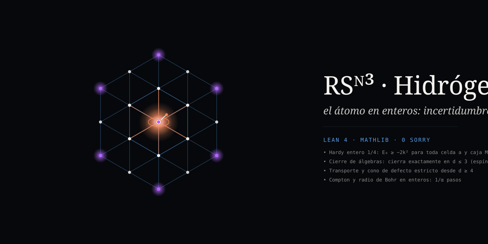

# RS^N³ · Hidrógeno

<div align="center">
  <video src="https://raw.githubusercontent.com/naype888-cloud/nrs3-hidrogeno/main/docs/media/intro.mp4" width="100%" controls autoplay loop muted playsinline></video>
  <p>
    <a href="https://naype888-cloud.github.io/nrs3-hidrogeno/">
      
    </a>
  </p>
  <p>
    <strong><a href="https://naype888-cloud.github.io/nrs3-hidrogeno/">▶ naype888-cloud.github.io/nrs3-hidrogeno</a></strong> · 
    <a href="https://naype888-cloud.github.io/nrs3-hidrogeno/Visualizador-Hidrogeno-NRS3-Bloch-Cubo.html">Visualizador 3D interactivo (Hidrógeno)</a>
  </p>
</div>

**El átomo de hidrógeno sobre los sitios enteros del cubo RS^N³.** La única forma de moverse es el
paso de eje, el `T_d` de cada eje (`D37`, `D39`); la celda del núcleo no lleva posición, solo un
estado; y ninguna cota depende de la celda `a` ni del tamaño de la caja. Lean 4 con Mathlib, sin
`sorry`, solo los axiomas `propext`, `Classical.choice` y `Quot.sound`.

Este repo es el **cubo abierto** (ejes con extremos, `D0`–`D49t` del teorema base). Las demás
topologías del mismo teorema están en sus propios repos: el toro `T³`, con cada eje cerrado, en
[`nrs3-tritoro`](https://github.com/naype888-cloud/nrs3-tritoro), y el eje cerrado y la fibra de Hopf en
[`nrs3-hopf`](https://github.com/naype888-cloud/nrs3-hopf). El hidrógeno de aquí no está hecho sobre ellas.

Los `d` son la discretización de cada par posición–momento `(P_d, T_d)` de los tres ejes. El
teorema base satura solo en `d = 2, 3` y es estricto desde `d = 4` ([`nava-robertson-schrodinger`](https://github.com/naype888-cloud/nava-robertson-schrodinger),
`D22`, `D37`, `D39`); este repo lo usa y no lo repite.

**[▶ El sitio](https://naype888-cloud.github.io/nrs3-hidrogeno/)**: el electrón saltando de eje en
eje sobre los sitios enteros, la bola de Bloch del primer paso y los teoremas de Lean.

## Resultados

### El modelo

| Enunciado | Lean |
|---|---|
| Los sitios son `p ∈ ℤ³`; la caja de semilado `M` sin la celda del núcleo | `cuboE` |
| Todo sitio distinto del núcleo está al menos a un paso: `a ≤ a·√(x²+y²+z²)` | `radiusE_ge` |
| La cinética es `⟨ψ, (6 − A) ψ⟩ / (2a²)`, con `A` la adyacencia de los saltos de eje | `kineticFull_eq` |
| Esa `A` es la del grafo `pathGraph dx □ (pathGraph dy □ pathGraph dz)` de `D37` | `adjForm_boxSet`, `kineticFull_boxSet` (`Caja.lean`) |
| …y es `ρₓTₓ + ρ_yT_y + ρ_zT_z`: la forma cuadrática del transporte de cada eje | `Puente.form_cube` (`Puente/D50g.lean`, dentro del corpus) |

### Hardy y la energía de la caja

| Enunciado | Lean |
|---|---|
| Hardy desde un campo sobre las aristas, sin celda ni tamaño | `edge_vf`, `hardy_vf` |
| El peso del campo `κ = (1/4) m / (m² + q + 1)` es `≥ 1/(4r²)` fuera del núcleo (cuerda por eje y un polinomio en una variable con coeficientes positivos) | `fax_eq`, `chord1`, `chord2`, `sum_phi`, `one_var`, `weight_ge` |
| **Hardy en los sitios enteros:** `(1/4) Σ ψ²/r² ≤ Σ aristas (Δψ)²`, para todo soporte finito con `ψ(núcleo) = 0` | `hardy_entero` |
| La energía de toda caja es `≥ −2k²`, para toda celda `a` y toda `M` | `energyE_ge_hardy`, `le_groundE_hardy` |
| También `≥ −k/a`, porque el sitio más cercano está a `a` | `energyE_ge`, `le_groundE` |
| Un solo sitio junto al núcleo da energía `3/a² − k/a`: cota superior | `energyE_trial`, `groundE_le_trial` |

### El límite: las cajas convergen y no se alcanza

| Enunciado | Lean |
|---|---|
| Crecer la caja solo baja la energía fundamental | `groundE_succ_le`, `levelsE_antitone` |
| Converge a su ínfimo `E∞`, y cada caja finita queda por encima | `tendsto_levelsE`, `limitE_le_levels` |
| `E∞` entre `max(−2k², −k/a)` y `3/a² − k/a` | `limitE_bounds` |

### Escala y velocidad

| Enunciado | Lean |
|---|---|
| El tope del cubo `2ta/ħ = ħ/(ma)` es `c` exactamente en la longitud de Compton reducida, `= α·a₀` | `cap_eq_c_iff`, `compton_eq_alpha_bohr` |
| La velocidad de Bohr es `α c`; el 1s anda a la fracción `α` del tope | `bohr_speed`, `bohr_speed_over_cap` |
| `‖vᵢψ‖ ≤ 2ta·‖ψ‖ = ‖ψ‖/a` en cualquier caja y a lo largo de cualquier eje | `vel_bound`, `vel_bound_cube`, `vel_bound_cuboE` |
| A escala de Compton, el sitio más cercano tiene energía de Coulomb `α m c²` | `coulomb_nearest_at_compton` |
| El radio de Bohr mide `1/α` pasos | `bohr_in_steps` |

El límite de velocidad de un estado de Dirac con masa `m`, `|⟨V⟩| ≤ √(1 + m²) − |m|`, está en
[`nrs3-hopf`](https://github.com/naype888-cloud/nrs3-hopf) (`DiracSpeed.abs_velocity_le`).

### El primer defecto y el primer tiempo (`d = 4`)

El defecto estricto de Robertson desde `d = 4` es la **incertidumbre elemental dimensional** del
[teorema base](https://github.com/naype888-cloud/nava-robertson-schrodinger): el exceso de la razón
sobre 1, `δ(d) = C_N(d) − 1`. Saturar es `δ = 0`, y solo pasa en `d = 2, 3`. En `4 × 4 × 4` es el
cuanto irreducible (`navaRobertsonSchrodinger_octahedron`, `D43`; `strict_inequality_of_maxTension`,
`D21`): ángulo mínimo `θ_NRS(4) ≈ 7.43°` y razón `1/C_N(4)² = 5/(99 − 42√5) ≈ 0.9833`. No se acerca a 0 al crecer `d`: sube de `δ(4) ≈ 0.00848` a `δ∞ ≈ 0.1357`, que ningún `d`
alcanza. Un paso dura `ℓ_P/c` en el piso, y el retraso del defecto es `δ · ℓ_P/c`.

| Enunciado | Lean |
|---|---|
| `C_N(4)² = (99 − 42√5)/5` | `CoherenceConstantSq_four_eq` (`D8`) |
| `δ(4) ≤ δ(d) < δ∞` para todo `d ≥ 4`, y `δ(4) > 0` | `geometricGap_four_le`, `geometricGap_lt_deltaInf`, `geometricGap_pos_of_four_le` (`D9`, `D8`) |
| `0.008478 < δ(4) < 0.008479` y `δ∞ < 0.13573` | `gap_four_bounds`, `deltaInf_lt_numeric` (`Puente/D50g.lean`) |
| Con `ℓ_P = 1.616255 × 10⁻³⁵ m` y `c = 299792458 m/s`, el primer tiempo `δ(4) · ℓ_P/c` está en `(4.57, 4.572) × 10⁻⁴⁶ s` | `delay_gap_four_bounds` |
| Para todo `d ≥ 4`, `0 < δ(4) t ≤ δ(d) t < δ∞ t`: el retraso no se acerca a 0 ni llega al límite, que es `δ∞ · ℓ_P/c < 7.32 × 10⁻⁴⁵ s` | `delay_gap_range`, `delay_inf_numeric` |
| Saturar es defecto de Gram `0`, y solo en `d = 2, 3` | `gramStep_gram_eq_zero_iff` (`D20`) |

En `d = 2, 3` el defecto y el retraso son 0.

### El primer paso del álgebra: la bola de Bloch (`d = 2`)

El par `(T, P) = (σₓ, σ_z)` es la fila 21 de la tabla de pares del teorema base (`(P₂, T₂)`). Para
el estado `ρ = ½(1 + xσₓ + yσ_y + zσ_z)`:

| Enunciado | Lean |
|---|---|
| El vector de Bloch es la tripleta de esperanzas de las Pauli | `ex_sx`, `ex_sy`, `ex_sz` |
| El defecto de Robertson–Schrödinger del par es `1 − (x² + y² + z²)` | `defect_eq` |
| La relación de incertidumbre es exactamente la bola: `‖v‖ ≤ 1` | `defect_nonneg_iff` |
| Se satura exactamente en la esfera, los estados puros | `defect_eq_zero_iff` |
| `ρ ≥ 0` si y solo si `‖v‖ ≤ 1` | `posSemidef_rho_iff` |

### Hasta dónde cierra el álgebra: `d = 2, 3`

El hop de la cadena es `T = S + Sᵀ` (`S` el desplazamiento) y `P` la posición `0, 1, …, d − 1`.

| Enunciado | Lean |
|---|---|
| `T` es la adyacencia del grafo camino de `d` posiciones | `Tp_eq_adj` |
| `[T, P] = Sᵀ − S` y `[P, [T, P]] = −T`, para todo `d` | `br_Tp_Pp`, `br_Pp_br_Tp_Pp` |
| `[T, [T, P]] = diag(−2, 0, …, 0, 2)`, un operador de frontera | `dbl_eq` |
| Es combinación de `P` y `1` si y solo si `d ≤ 3`: `{T, P, [T, P], 1}` cierra en `d = 2, 3` y no desde `d = 4` | `closes_iff` |

El corpus ya prueba este cierre para sus `T_d`, `P_d` normalizados (`D49i`: `closure_iff`,
`commutator_P_C`); aquí hay una prueba independiente, solo con Mathlib, sobre el hop sin
normalizar. La frontera coincide con la de `saturada_TdPd_iff` (`D22`): el teorema base satura solo
en `d = 2, 3`.

### Es el espín: `d = 2, 3`

| Enunciado | Lean |
|---|---|
| `d = 2`: el hop es `σₓ` y la posición es `(1 − σ_z)/2` | `Tp_two`, `Pp_two` |
| `d = 3`: el hop, `Y = i[T, P]` y `Z = P − 1` son matrices explícitas | `Tp_three`, `Pp_three`, `Y3_eq` |
| …y cumplen las relaciones del momento angular de espín 1: `[T,Y] = 2iZ`, `[Y,Z] = iT`, `[Z,T] = iY` | `comm_T3_Y3`, `comm_Y3_Z3`, `comm_Z3_T3` |
| …con el Casimir `T² + Y² + 2Z² = 4`, es decir `J² = j(j+1) = 2` con `j = 1` | `casimir_three` |

Con `Jₓ = T/√2`, `J_y = Y/√2`, `J_z = Z`. El álgebra de Pauli de `σ` está probada en
[`nrs3-pauli-dirac`](https://github.com/naype888-cloud/nrs3-pauli-dirac) (`sigma_anticomm`,
`sigma_mul`, `no_four_anticommuting`).

### La esfera de `d = 3` es la esfera de Bloch

Un qubit `(a, b)` de norma 1 tiene el cuadrado simétrico `ψ = (a², √2·ab, b²)`, un estado de las tres
posiciones. Para el salto `T` y la posición `Z = P − 1` de arriba:

| Enunciado | Lean |
|---|---|
| Los vectores centrados `(T − ⟨T⟩)ψ` y `(Z − ⟨Z⟩)ψ` son múltiplos de un mismo vector: `(a² − b²)·χ` y `√2·ab·χ` | `cen_T`, `cen_Z` |
| El defecto de Gram (la brecha de Cauchy–Schwarz de los dos vectores centrados) es `0`: **estos estados saturan en `d = 3`**, como los estados puros en `d = 2` | `coherent_saturates` |
| `⟨T⟩ = √2 · 2 Re(ā b)` y `⟨Z⟩ = \|b\|² − \|a\|²`: son las coordenadas del vector de Bloch del qubit `(a, b)` | `mean_T_re`, `mean_Z_re` |
| Ese vector está en la esfera unitaria | `sphere` |

No son todos los estados que saturan en `d = 3`: la clasificación completa es la de `D23`
(`gramDefectAt_eq_zero_iff`, los vectores centrados proporcionales), y por ejemplo un estado con
`Var Z = 0` satura sin ser coherente.

### El cubo abierto, del mismo cierre (corpus)

Las mismas relaciones, `[P, [T, P]] = −h² T` para todo `d` y el cierre de `D49i` solo en
`d = 2, 3`, son la herramienta del cubo abierto en el
[teorema base](https://github.com/naype888-cloud/nava-robertson-schrodinger). No se repiten aquí:

| Enunciado | Lean (corpus) |
|---|---|
| En el estado de corriente máxima del cubo, `det Σ` es el producto de los de cada eje; la razón es `C_N(dx)² C_N(dy)² C_N(dz)²`, que vale `1` solo si todo eje tiene 2 o 3 posiciones | `det_covMatrix_maxCurrentCubeState` (`D49c`) |
| Desde `4 × 4 × 4` es estricta en ese estado | `robertson_det_maxCurrentCubeState_strict` (`D49c`) |
| Con las velocidades de los tres ejes en su banda `Ϙ(d)`, `\|det Ω\| < det Σ` para **todo** estado, sin producto ni ejes canónicos | `robertson_det_band_strict` (`D49t`) |
| Un eje libre no deja ningún estado en la igualdad: `T Φ = 0` y `[T, P] Φ = 0` fuerzan `Φ = 0` | `D49l`, `D49n`, `D49r`, `D49s` |

## Lo que no está probado

- Que `E∞` sea el nivel de Rydberg.
- La relación formal entre el cierre del álgebra y la saturación de Robertson: el corpus los
  presenta como la misma ruptura en `d = 4` (`D49i`); este repo no la formaliza.
- Que `1/4` sea la mejor constante de `hardy_entero`: está probada como cota, no como óptima.
- El amarre en Lean de `evaluacionTdPd 2` (corpus, `D22`) con `BolaDeBloch.lean`. Para todo
  `d ≥ 2` el corpus ya prueba la saturación y el defecto (`saturada_TdPd_iff`,
  `defectoIntrinseco_TdPd_eq_defectoGram`, `D39`).
- El origen de `ℤ³` en la celda del núcleo es una convención de este repo, no un enunciado del
  teorema base.

## Construir

```
lake build
tools/verificar.sh      # además compila Puente/D50g.lean dentro del corpus
```

Solo Mathlib `v4.35.0` (Lean `4.35.0`). `Puente/D50g.lean` importa el corpus
([`nava-robertson-schrodinger`](https://github.com/naype888-cloud/nava-robertson-schrodinger)) y se
compila dentro de él: `cd nava-robertson-schrodinger && lake env lean ../nrs3-hidrogeno/Puente/D50g.lean`.

**Historia.** Los commits anteriores a «Retira el modelo con medias celdas» usan celdas con centro en
`(i + ½)a` y la cota `E₀ ≥ −10k²`. Ese modelo está retirado: no hay distancia menor a un paso. Los
archivos que lo contenían ya no están en el árbol.

## Línea de tiempo 1911–1945

| Año | Evento | Aquí |
|---|---|---|
| 1913 | Bohr: el átomo y su radio | `bohr` |
| 1916 | Sommerfeld: la constante de estructura fina | `alpha` |
| 1920 | Hardy: su desigualdad | `hardy_entero` |
| 1929–30 | Robertson y Schrödinger: la desigualdad de incertidumbre | `defect_eq` |

**Antecedentes y herramientas fuera de la ventana.** Fiedler (1973), Lean 4 y Mathlib.

## El mosaico

- [RS^N y RS^N³ — el teorema base](https://github.com/naype888-cloud/nava-robertson-schrodinger)
- [RS^N³ · Mandelstam–Tamm y Cramér–Rao](https://github.com/naype888-cloud/nrs3-mandelstam-tamm-cramer-rao)
- [RS^N³ · Landauer y Carnot](https://github.com/naype888-cloud/nrs3-landauer-carnot)
- [RS^N³ · de Sitter](https://github.com/naype888-cloud/nrs3-de-sitter)
- [RS^N³ · Penrose](https://github.com/naype888-cloud/nrs3-penrose) (propuesta)
- [RS^N³ · Pauli–Dirac](https://github.com/naype888-cloud/nrs3-pauli-dirac)
- [RS^N³ · El cono de la incertidumbre](https://github.com/naype888-cloud/nrs3-uncertainty-cone)
- [RS^N³ · Poincaré](https://github.com/naype888-cloud/nrs3-poincare)
- [RS^N³ · Defecto y curvatura](https://github.com/naype888-cloud/nrs3-defect-curvature)
- [RS^N³ · Rovelli — Loop Quantum Gravity](https://github.com/naype888-cloud/nrs3-rovelli-lqg) (propuesta)
- [RS^N³ · Dark](https://github.com/naype888-cloud/nrs3-dark)
- [RS^N³ · Cristales](https://github.com/naype888-cloud/nrs3-cristales)
- **[RS^N³ · Hidrógeno](https://github.com/naype888-cloud/nrs3-hidrogeno)** (este)

## Licencia

NRS Noncommercial License 1.0.0, ver [`LICENSE`](LICENSE). Autor: Eduardo Nava-Hernandez.
